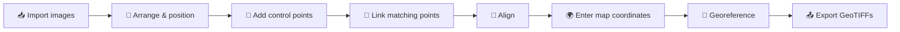

<div align="center">


# GeoStitch

**Bring in raster images, stitch them together virtually, and georeference them against the real world.**


[Overview](#-overview) · [Workflow](#-workflow) · [Tools](#-tools-and-shortcuts) · [Panels](#-workspace-panels) · [Export](#-exporting) · [Project files](#-project-files) · [Development](#-development)

</div>

---

## ✨ Overview

GeoStitch is a desktop workspace for turning a pile of unreferenced raster images (scanned maps, drone frames, survey sheets, aerial photos) into correctly placed, georeferenced layers.

Instead of stitching pixels, you work **virtually**:

1. Lay all images out on one shared canvas.
2. Mark features that appear in more than one image and **link** them.
3. Let the solver **align** the images to each other.
4. Give some points real-world coordinates and let the solver **georeference** every image.
5. **Export** each image as a GeoTIFF or a world-file image, ready for GIS software.

> [!NOTE]
> Images are never warped or resampled into a single mosaic. Each image is exported with its own georeferencing, so the result drops straight into QGIS, ArcGIS, or any tool that reads GeoTIFFs and world files.

### Highlights

|     | Feature                                                                                |
| --- | -------------------------------------------------------------------------------------- |
| 🖼️  | Shared, pannable and zoomable canvas for any number of images                          |
| 🧲  | Drag, rotate and scale layers with on-canvas handles                                   |
| 📍  | Continuous control-point placement with screen-sized markers                           |
| 🔗  | Tie-point links between matching features in different images                          |
| 📐  | Least-squares alignment and georeferencing with residual reports                       |
| 🗺️  | Live OpenStreetMap world map showing solved footprints, with click-to-pick coordinates |
| ✂️  | Per-image clip polygons (keep inside or outside) applied on export                     |
| 🧩  | GeoJSON vector overlays reprojected to the project CRS                                 |
| ↩️  | Full undo/redo for project edits                                                       |
| 🧱  | Dockable, floatable, splittable panels with remembered layout and custom shortcuts     |

---

The window appears before automatically reopening the last project. Saved-project images decode on background workers and appear progressively; the layer tree is available while they load. SciPy's optimizer and image-export dependencies load only when those commands are used. GeoJSON loading already runs on background workers.

Open **File > Settings > Appearance** (also available under **Settings**) to choose an installed Qt style, the GeoStitch dark scheme or Qt's default palette, and symbol colors for images, control points, links, and GeoJSON layers. Color swatches open a color picker. Apply updates the views immediately; OK applies and closes; Cancel discards changes not yet applied. Restore Defaults resets the dialog to Fusion, the dark scheme, and the original symbol colors. Appearance preferences are saved independently of projects.

## 🔄 Workflow



### 1. 📥 Import images

Use **File → Import images** (`Ctrl+I`) or drag files into the window. New layers are laid out in a balanced, near-square grid. Choose the project **coordinate system** (for example `EPSG:32610`) in the details panel or the map toolbar.

### 2. 🧲 Arrange and position

- Drag a layer to move it.
- Select a layer to show handles: drag a **corner** to scale proportionally, or the **handle above the image** to rotate.
- **Arrange images** (`Ctrl+Shift+A`) rebuilds the grid; **Fit current view** (`Ctrl+Shift+F`) zooms to the selection or everything.
- The Layers panel shows a padlock beside each image and control point. Click it to lock or unlock that row without changing selection: images lock their rest transform, while points lock their pixel position. Open padlocks are unlocked; closed padlocks are locked. GeoJSON rows have no lock control.

### 3. 📍 Add control points

Toggle **Add points** (`P`) and click features. Every click creates one point belonging to the clicked image, displayed as a compact per-image sequence (`P1`, `P2`, ...). Different images can display their own `P1`; unique stored names and IDs still distinguish them. The tool stays active until you toggle it off. Give points optional labels, edit pixel positions, or **lock** them (`K`) to prevent accidental drags. Labels appear beside the short name, such as `P3 · Bridge`; hover for full image context and the unique stored name. Existing custom point names are preserved, and explicitly editing a point name replaces its automatic alias with your custom name. Select images and press `K` to lock their canvas rest position, rotation, and scale, including against Arrange. Image locks are saved with the project and do not lock point observations or solver-aligned and geographic transforms. For a mixed selection, `K` locks all selected image transforms and point positions unless all are already locked, in which case it unlocks them.

### 4. 🔗 Link matching points

Toggle **Link points** (`L`), click a marker, then click its match in a **different** image. The tool stays active for successive pairs. You can also select a point and choose **Link selected point to...** (`Ctrl+Shift+L`). Links appear as dashed lines in the scene.
In the Layers panel, expand a linked control point to see its constraints. Links receive stable names (`L1`, `L2`, ...), saved with the project and not reused after deletion. Rows show the link and other point, such as `L1 → P2`; non-default constraint types are shown, while the default `tie` is omitted. Hover for both images and endpoints, labels, type, and available alignment residual. Point pickers include image context to distinguish local aliases. Select a link row to highlight the constraint and show its details; Delete removes the link without removing either point.

### 5. 📐 Align

**Image > Align** (`Ctrl+Shift+M`) runs immediately with the current project settings. It jointly fits all linked observations for each connected image group, solving translation, rotation and uniform scale with bounded least squares. One reference image per group stays fixed. Results apply automatically when the target tolerance is reached and can be undone. Use **Toggle aligned / rest layout** (`A`) to flip between the arranged and aligned canvas.

The solver toolbar group contains three controls: **Align**, **Georeference**, and **Align + Georeference**. Align and Georeference each have a small settings gear in their bottom-right corner; clicking the main icon runs the solver, while clicking the gear opens its settings. Settings dialogs offer **Apply**, **Run**, and **Cancel** for tolerance, maximum iterations, and automatic application. Apply saves settings without running; Run saves and executes. Uncheck automatic application to compute a preview without changing transforms. Settings are saved per project. Detailed results are available through the Image menu's last-report commands; alignment reports are saved with projects, while georeferencing reports describe the latest run in the current session.

**Align + Georeference** computes alignment first and uses that fresh layout for georeferencing. When both stages reach their targets and automatic application is enabled for both, the transforms apply together as one undo step. Preview mode in either solver leaves both sets of transforms unchanged. A missed target stops for review with **Apply best result**, **Adjust settings**, or **Discard**; the combined run does not continue past an alignment target miss. Cancellation or solver failure retains existing transforms.

The Layers **Error** column shows alignment residuals in **scene units**: RMS of incident links for each image, the largest incident-link residual for each point, and the solved endpoint distance for each link. Hover over a value for its full precision and meaning. The canvas **Alignment errors** toggle colors links green within the solve's target tolerance, amber within twice that tolerance, and red above it. Selected links keep a thicker solid stroke and highlight both endpoints; the canvas readout follows the selected image, point, or link.

Changing observations, links, or rest transforms marks the previous solve **Outdated**, grays its Layers values, and turns off residual coloring. Undoing those changes restores current results. Coloring is available in both rest and aligned layouts, including current simulations that have not been applied in rest mode. In rest mode, colors show the last solve's residuals, not the gaps between the displayed endpoints. The aligned layout must match the solve to show its colors. Saving a project also saves the last examined residual report, target tolerance, and original solve inputs. Reopening restores the same values and current/outdated state without rerunning the solver, including unapplied simulations. Older projects without a saved report show unavailable errors until alignment is run and the project is saved again. These values measure alignment fit, not independent geographic accuracy; point values are link errors, not geographic target errors.

### 6. 🌍 Enter map coordinates

Give some points real coordinates in the project CRS: type them in the details panel, or toggle **Pick GCP coordinate on map** (`G`) and click the world map.

### 7. 🧮 Georeference

**Image > Georeference** (`Ctrl+Shift+G`) runs with the saved georeferencing settings and solves pixel-to-world transforms from points with map coordinates. Successful results apply automatically by default. The last-report command lists residuals per image and point in CRS units. Applied transforms are stored separately from the canvas layout, and images with a solved transform appear on the world map.

### 8. 📤 Export

**File → Export georeferenced images** (`Ctrl+E`). See [Exporting](#-exporting).

> [!TIP]
> Alignment and georeferencing are both undoable, so experiment freely.

---

## 🛠️ Tools and shortcuts

All shortcuts can be changed in **Settings → Keyboard shortcuts...** (duplicates are rejected; _Restore defaults_ resets them).

| Tool / command                  |              Key               | Description                                                 |
| ------------------------------- | :----------------------------: | ----------------------------------------------------------- |
| Add points                      |              `P`               | Click images to create control points continuously          |
| Link points                     |              `L`               | Click two matching points in different images               |
| Pick GCP coordinate on map      |              `G`               | Click the world map to set the selected point's coordinates |
| Lasso selection                 |              `S`               | Toggle freehand lasso instead of rectangle selection        |
| Lock / unlock images and points |              `K`               | Lock image rest transforms and selected point positions     |
| Toggle aligned / rest layout    |              `A`               | Switch between arranged and solver-aligned layouts          |
| Maximize / restore panel        |              `M`               | Focus on one panel                                          |
| Delete selected                 |             `Del`              | Remove selected images, points or link                      |
| Select all / Deselect all       |      `Ctrl+A` / `Ctrl+D`       |                                                             |
| Undo / Redo                     |      `Ctrl+Z` / `Ctrl+Y`       |                                                             |
| New / Open / Save               | `Ctrl+N` / `Ctrl+O` / `Ctrl+S` | `Ctrl+Shift+S` for Save as                                  |
| Import images                   |            `Ctrl+I`            |                                                             |
| Export georeferenced images     |            `Ctrl+E`            |                                                             |
| Fit current view                |         `Ctrl+Shift+F`         | Fits canvas, map or image view, whichever you are in        |
| Arrange images                  |         `Ctrl+Shift+A`         |                                                             |
| Align                           |         `Ctrl+Shift+M`         | Runs with the current project settings                      |
| Georeference from GCPs          |         `Ctrl+Shift+G`         |                                                             |
| Link selected point to...       |         `Ctrl+Shift+L`         |                                                             |

**Mouse:** wheel to zoom, middle-drag to pan. In select mode, `Ctrl` adds to the selection and `Shift` drags over images.

World Map wheel zoom is animated around the cursor and supports fractional wheel input. Tile requests settle after zoom motion instead of restarting on every frame. Existing tiles remain visible while replacements fade in, including when zooming out; a bounded decoded-tile cache makes returning to recently viewed areas quicker. Fit, pan, and restored views stop pending zoom motion.

---

## 🪟 Workspace panels

| Panel              | Purpose                                                                                                            |
| ------------------ | ------------------------------------------------------------------------------------------------------------------ |
| **Images**         | Layer list; select, reorder and remove images                                                                      |
| **Image Canvas**   | Shared workspace for positioning images and placing points and links                                               |
| **Image View**     | Single-image view for precise point placement                                                                      |
| **Control Points** | Points and links for the active image, with editable pixel and map coordinates, names, labels and constraint types |
| **World Map**      | OpenStreetMap basemap with solved image footprints, GeoJSON overlays, and coordinate picking                       |

Panels can be docked, floated, closed, or split by dragging a title bar to another panel's edge. The layout is restored on next launch; use **View → Reset panel layout** to return to the default.

> [!NOTE]
> Map tiles are fetched from `tile.openstreetmap.org` and cached locally, so an internet connection is needed for uncached areas. © OpenStreetMap contributors.

### Extras

- **Clip polygons** - draw a polygon on an image and keep the inside or outside; applied on export, with a cutline GeoJSON written alongside.
- **GeoJSON layers** - **File → Import GeoJSON layers** overlays vector data, reprojected to the project CRS.

---

## 📤 Exporting

Every image with a solved world transform is written to the folder you choose as `<name>_georef.<ext>`.

| Format            | Output                              |
| ----------------- | ----------------------------------- |
| GeoTIFF           | `.tif` with embedded georeferencing |
| PNG + world file  | `.png` + `.pgw`                     |
| JPEG + world file | `.jpg` + `.jgw`                     |

Clipped images additionally produce a `_cutline.geojson` (and a `_mask.png` for formats without alpha).

---

## 💾 Project files

Projects are saved as versioned JSON `.gsp` files containing image paths and transforms, points and labels, observations, map coordinates, the CRS, constraints, and view state. Version 14 added the last examined alignment residual report; version 15 added settings for both solvers; version 16 added compact point aliases and stable link names. Version 17 stores one authoritative alignment report, deriving point and image summaries from its original solve inputs instead of saving redundant summary maps. Older project and report versions remain readable, retain their point names, receive link numbers on load, and receive default solver settings where needed.

Changing the project CRS refits world transforms using the saved georeferencing tolerance and iteration limit, with the same cancellable progress as the normal solver. Cancelling or failing the refit restores the previous CRS, coordinates, transforms, and report. A completed CRS change remains a single undo step; automatic-application settings for manual previews do not suppress the refit needed for the new coordinate system.

> [!WARNING]
> Projects reference the **original image files on disk**. Moving or renaming them breaks the references.

Older files with multi-image points are split into linked per-image points on load.

---

## 📦 Install and run

Requires **Python 3.10+**.

```powershell
python -m venv .venv
.venv\Scripts\Activate.ps1
python -m pip install -e ".[test]"
python -m geostitch
```

---

## 👩‍💻 Development

### Layout

```text
src/geostitch/
├── app.py            # main window, tools, panels, dialogs
├── canvas.py         # shared image canvas
├── image_view.py     # single-image view
├── map_view.py       # world map and tiles
├── models.py         # Qt-independent project data
├── project_io.py     # .gsp serialization
├── adjustment.py     # alignment solver
├── georeference.py   # GCP georeferencing solver
├── export.py         # GeoTIFF / world-file export
├── masking.py        # clip polygons
├── vector*.py        # GeoJSON loading and reprojection
└── assets/           # icons and images
tests/                # pytest suite
packaging/            # PyInstaller specs, build script, installer
```

### Conventions

- Keep Qt UI code in `src/geostitch`; keep `models.py` free of Qt.
- A control point belongs to exactly one image; points in different images relate only through constraints.
- Keep `.gsp` serialization backward compatible and covered by tests.

### Tests

```powershell
python -m pytest
```

In VS Code, pick **GeoStitch: desktop app** under **Run and Debug** and press **F5** to launch under the debugger.

### Building executables

```powershell
.\packaging\build.ps1            # folder build + Inno Setup installer
.\packaging\build.ps1 -OneFile   # single self-contained dist\GeoStitch.exe
```

The installer step requires [Inno Setup 6](https://jrsoftware.org/isinfo.php).
